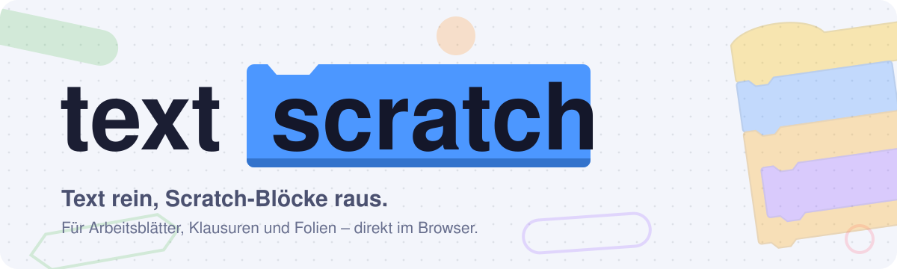
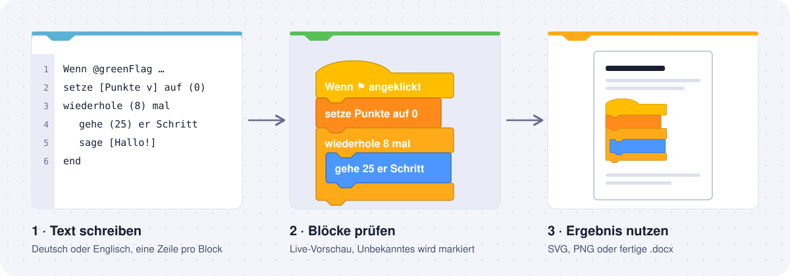
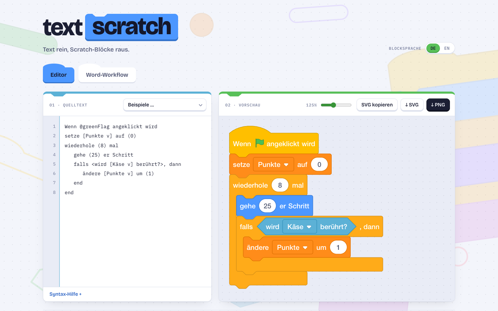
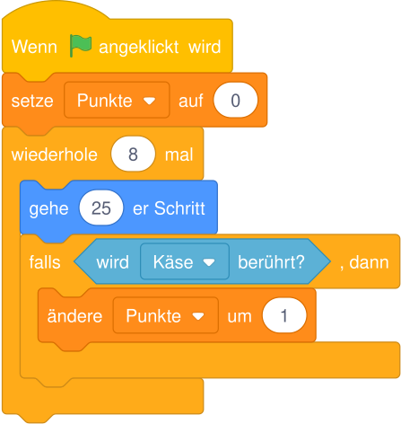
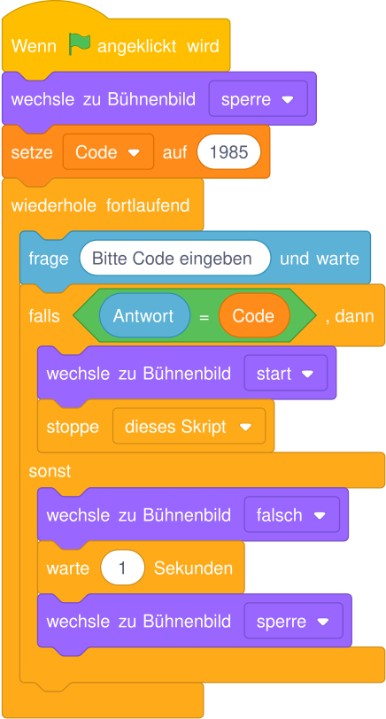
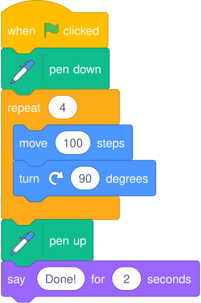
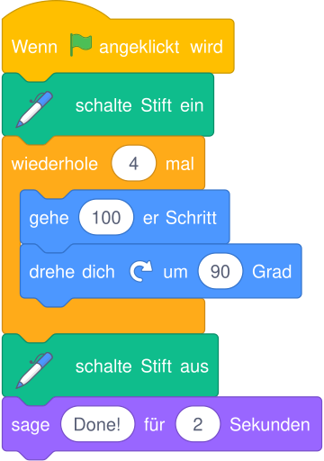

<p align="center">
  
</p>

<p align="center">
  <a href="https://cuxbytes.github.io/text2scratch/"><strong>Jetzt im Browser öffnen →</strong></a>
</p>

**text2scratch** verwandelt Scratch-Skripte, die als Text geschrieben sind, in saubere Scratch-3-Blöcke. Gedacht ist das Werkzeug für alle, die Blöcke nicht nur am Bildschirm, sondern auf Papier brauchen: in Arbeitsblättern, Klausuren, Erwartungshorizonten oder Präsentationen. Statt Screenshots aus dem Scratch-Editor auszuschneiden, schreibt man das Skript in wenigen Zeilen und erhält gestochen scharfe Grafiken, die sich jederzeit ändern lassen.

Alles läuft lokal im Browser. Es gibt keinen Server, kein Konto und keine Datei, die den eigenen Rechner verlässt.

<p align="center">
  
</p>

## Auf einen Blick

<picture>
  <source media="(prefers-color-scheme: dark)" srcset="docs/screenshot-editor-dark.png">
  
</picture>

- **Editor mit Live-Vorschau.** Links steht der Text, rechts erscheinen die Blöcke, während man tippt. Nicht erkannte Blöcke werden grau dargestellt und zusätzlich unter der Vorschau aufgelistet, damit Tippfehler sofort auffallen.
- **Export als SVG oder PNG.** SVG bleibt in jeder Größe scharf und eignet sich für Folien und Webseiten. PNG wird in hoher Auflösung (288 dpi) erzeugt und ist damit druckfertig.
- **Word-Workflow.** Eine `.docx`-Datei mit Platzhaltern hochladen, die erkannten Skripte prüfen und bei Bedarf korrigieren, dann eine fertige Word-Datei mit eingesetzten Block-Bildern herunterladen.
- **Zwei Sprachen.** Skripte dürfen deutsche oder englische Schlüsselwörter enthalten, auch gemischt. Die Blöcke selbst lassen sich wahlweise auf Deutsch oder Englisch ausgeben.

## Aus Text werden Blöcke

Ein Block pro Zeile, Einrückungen dienen nur der Lesbarkeit. Dieses kurze Skript …

```text
Wenn @greenFlag angeklickt wird
setze [Punkte v] auf (0)
wiederhole (8) mal
   gehe (25) er Schritt
   falls <wird [Käse v] berührt?>, dann
      ändere [Punkte v] um (1)
   end
end
```

… ergibt diese Grafik (unverändert aus dem SVG-Export):

<p align="center">
  
</p>

Auch längere Skripte mit Verzweigungen bleiben übersichtlich, etwa diese PIN-Sperre aus einer Klausur der Klasse 10:

<details>
<summary>Quelltext und Ergebnis anzeigen</summary>

```text
Wenn @greenFlag angeklickt wird
wechsle zu Bühnenbild [sperre v]
setze [Code v] auf (1985)
wiederhole fortlaufend
   frage [Bitte Code eingeben] und warte
   falls <(Antwort) = (Code)>, dann
      wechsle zu Bühnenbild [start v]
      stoppe [dieses Skript v]
   sonst
      wechsle zu Bühnenbild [falsch v]
      warte (1) Sekunden
      wechsle zu Bühnenbild [sperre v]
   end
end
```

<p align="center">
  
</p>
</details>

### Ein Skript, zwei Blocksprachen

Ein Skript mit englischen Schlüsselwörtern lässt sich ebenso als deutsche Blöcke ausgeben. Die Übersetzung übernimmt text2scratch.

```text
when flag clicked
pen down
repeat (4)
   move (100) steps
   turn right (90) degrees
end
pen up
say [Done!] for (2) seconds
```

<table>
  <tr>
    <th>Blocksprache Englisch</th>
    <th>Blocksprache Deutsch</th>
  </tr>
  <tr>
    <td align="center"></td>
    <td align="center"></td>
  </tr>
</table>

## Syntax in Kürze

| Schreibweise | Bedeutung | Beispiel |
| --- | --- | --- |
| `(…)` | runde Eingabe, meist eine Zahl | `gehe (10) er Schritt` |
| `[…]` | eckige Eingabe für Text | `sage [Hallo!]` |
| `[… v]` | Auswahlliste (Dropdown) | `setze [Punkte v] auf (0)` |
| `<…>` | Bedingung (sechseckiger Block) | `falls <wird [Rand v] berührt?>, dann` |
| `end` | schließt einen C-Block wie `wiederhole` oder `falls` | |
| `sonst` / `else` | zweiter Zweig eines `falls`-Blocks | |
| `@greenFlag` | Symbol der grünen Flagge | `Wenn @greenFlag angeklickt wird` |

Für Lückentexte in Klausuren eignen sich Platzhalter wie `( ① )` oder `[ ② v]`. Die vollständige Referenz steht im [Scratch-Wiki](https://en.scratch-wiki.info/wiki/Block_Plugin/Syntax).

## Word-Dokumente automatisch bestücken

Für Arbeitsblätter und Klausuren muss man die Bilder nicht einzeln einfügen. Man markiert im Word-Dokument, wo ein Skript hingehört, und text2scratch erledigt den Rest.

**1. Platzhalter anlegen.** Eine Tabelle mit genau einer Zelle einfügen. In die erste Zeile kommt die Kennung, danach das Skript, zum Schluss die Endmarke:

```text
[[SB:a1_code]]
Wenn @greenFlag angeklickt wird
gehe (10) er Schritt
[[/SB]]
```

Die Kennung nach `SB:` darf Buchstaben, Ziffern und Unterstriche enthalten und sollte im Dokument eindeutig sein, zum Beispiel nach Aufgabennummer: `a1_code`, `a2b_code`.

**2. Dokument hochladen.** Im Reiter *Word-Workflow* die Datei hineinziehen oder auswählen. text2scratch zeigt alle gefundenen Skripte als Vorschau an. Jedes lässt sich dort noch korrigieren, ohne das Word-Dokument erneut öffnen zu müssen.

**3. Fertige Datei herunterladen.** Jede Platzhalter-Tabelle wird durch ein PNG mit 288 dpi ersetzt. Text, Formatierung, Kopf- und Fußzeilen bleiben unverändert. Wer die Bilder lieber selbst platziert, lädt sie gesammelt als ZIP-Archiv herunter.

Zum Ausprobieren liegt eine Beispiel-Klausur bei: [`static/demo/demo-klausur.docx`](static/demo/demo-klausur.docx). Sie lässt sich in der App auch direkt über *Demo-Klausur laden* öffnen.

## Datenschutz

text2scratch ist eine rein statische Webseite. Dokumente werden ausschließlich im Browser gelesen und erzeugt, Schriften sind mitgeliefert, und es werden keine Analyse- oder Tracking-Dienste eingebunden. Damit eignet sich das Werkzeug auch für Prüfungsunterlagen, die nicht in fremde Hände gehören.

## Entwicklung

Voraussetzung ist eine aktuelle Node.js-Version.

```bash
npm install
npm run dev        # Entwicklungsserver auf http://localhost:5173
npm run check      # Typprüfung mit svelte-check
npm test           # Regressionstests für den .docx-Export
npm run build      # statische Seite nach build/
npm run demo:docx  # Demo-Klausur neu erzeugen
```

| Pfad | Inhalt |
| --- | --- |
| `src/lib/scratch.ts` | Rendern mit scratchblocks, Export als SVG und PNG |
| `src/lib/docx.ts` | Platzhalter in `.docx`-Dateien finden und durch Bilder ersetzen |
| `src/lib/components/` | Editor, Word-Workflow und der dekorative Block-Hintergrund |
| `src/lib/i18n.svelte.ts` | Oberflächentexte auf Deutsch und Englisch |
| `docs/` | Grafiken für diese README |

Jeder Push auf `main` baut die Seite über GitHub Actions und veröffentlicht sie auf GitHub Pages.

## Danksagung

Gebaut mit [SvelteKit](https://svelte.dev), [scratchblocks](https://github.com/scratchblocks/scratchblocks) (MIT) und [JSZip](https://stuk.github.io/jszip/).

Scratch ist ein Projekt der Scratch Foundation in Zusammenarbeit mit der Lifelong Kindergarten Group am MIT Media Lab. text2scratch ist ein unabhängiges Projekt und steht in keiner Verbindung zu Scratch.
